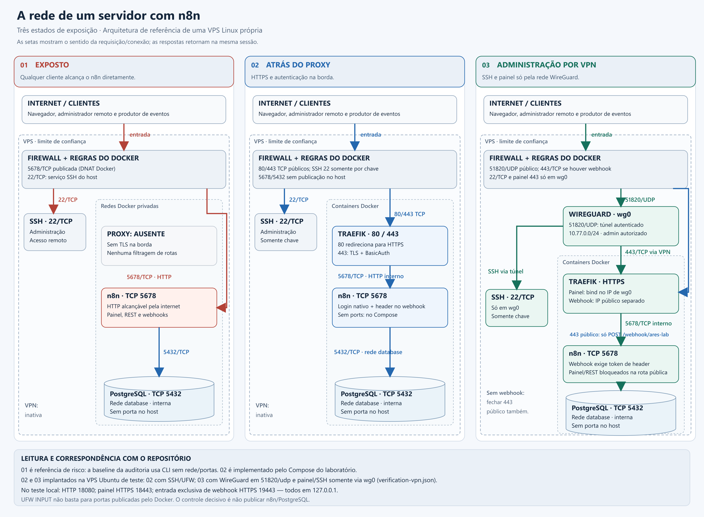

# n8n endurecido com Traefik — laboratório ARES

Laboratório que sobe um n8n endurecido atrás do Traefik com Docker Compose: HTTPS obrigatório com BasicAuth no proxy, login nativo do n8n, banco em rede interna sem portas publicadas, webhook restrito por método/caminho/token e auditoria de segurança antes/depois com evidências reais. Um [diagrama da arquitetura em três estados de exposição](diagrams/n8n-three-states.png) acompanha este repositório.

## Início rápido

```bash
git clone https://github.com/MarcosSMZ94/n8n-lab.git
cd n8n-lab
python scripts/lab.py init
python scripts/lab.py up
```

Abra **https://localhost:18443/**: sem credenciais, a resposta é 401 do BasicAuth do Traefik; depois, exige o login nativo do n8n. As duas credenciais ficam em `.local/access.json`. Requisitos, aviso sobre a fixture e comandos de parada: [Executar](#executar).

## Executar

Pré-requisitos: Docker Engine Linux/Docker Desktop com motor Linux ativo, Docker Compose 2.24.4 ou superior, Python 3.10+ e OpenSSL. No Windows, o script também encontra o OpenSSL do Git for Windows. Sem npm/pip install. Recomenda-se pelo menos 2 GB de RAM para este stack básico. A VPS de avaliação tem cerca de 1 GB e recebeu 2 GB de swap; sua capacidade serve à fixture, sem dimensionar produção.

```bash
python scripts/lab.py init
python scripts/lab.py before
python scripts/lab.py up
python scripts/lab.py verify
python scripts/lab.py after
```

No Windows, se `python` for apenas um atalho da Microsoft Store, use um Python instalado ou o runtime indicado pelo Codex. Os comandos aceitam `py` quando o Python Launcher estiver configurado.

Abra **https://localhost:18443/**. As duas credenciais distintas estão em `.local/access.json`: `proxy_user`/`proxy_password` para o Traefik e `owner_email`/`owner_password` para o n8n. O email `.invalid` é sintético; nenhum SMTP está configurado. O script não imprime senhas. O certificado é de teste, com SAN `localhost` e `127.0.0.1`, válido por 30 dias. O navegador não confia nele automaticamente; os testes validam sua cadeia usando o certificado gerado, sem desativar a verificação TLS.

`init` se recusa a sobrescrever segredos existentes. `up` importa a credencial e o workflow sintéticos, publica a versão com a aplicação parada e inicia o stack. Usar `up` novamente restaura essa fixture de laboratório; não use este comando em uma instância com workflows pessoais. Para apenas iniciar a configuração existente: `docker compose up -d --wait`.

No Linux, os arquivos privados continuam com permissão 0600. A importação passa seu conteúdo por stdin para um arquivo temporário 0600 no container, removido ao terminar; a aplicação não monta a pasta de fixtures. O UID/GID do proxy é ajustado ao usuário que executa `init`, permitindo ler o certificado e o arquivo bcrypt privados mesmo com capabilities removidas.

```bash
# Parar, preservando banco e volumes:
python scripts/lab.py down
# Retomar a mesma instância, sem reimportar o workflow:
docker compose up -d --wait
```

Todos os comandos Compose operam apenas neste projeto. Não há `--remove-orphans`, rede externa de produção nem nomes de volumes de outro projeto.

## Portas e redes

| Serviço | Dentro do container | No host, configuração padrão |
|---|---|---|
| Traefik HTTP | TCP 8080 | `127.0.0.1:18080` → redirect HTTPS |
| Traefik painel | TCP 8443 | `127.0.0.1:18443` → BasicAuth + login n8n |
| Traefik webhook | TCP 9443 | `127.0.0.1:19443` → só POST no caminho permitido |
| n8n | TCP 5678 | Nenhuma publicação |
| Broker de tarefas | TCP 5679, loopback do container | Nenhuma publicação |
| PostgreSQL | TCP 5432 | Nenhuma publicação |

`proxy` conecta apenas Traefik e n8n. `database`, com `internal: true`, conecta apenas n8n e PostgreSQL. O Traefik não está na rede do banco. A rede do proxy permite saída para os serviços externos usados por workflows; o laboratório não constitui uma política completa de bloqueio de saída/SSRF.

Sobre `PROXY_UID=0`: o default existe para Docker Desktop, onde arquivos montados do Windows não têm dono igual ao do container. No Linux, `init` troca o valor pelo UID/GID de quem o executou, para o Traefik — sem capabilities — conseguir ler o certificado e o arquivo de usuários 0600. O processo no container só escuta portas altas (8080/8443/9443); o bind de 80/443 no host do perfil VPS é feito pelo dockerd, não pelo Traefik. Com `cap_drop: ALL`, `no-new-privileges` e filesystem somente leitura, UID 0 no container não concede privilégios de kernel.

No cenário de VPS do diagrama, 80/443 são as portas da borda e 22 é a porta ilustrativa de SSH. As portas altas do teste local evitam conflito com outros serviços do computador. O terceiro estado usa interfaces distintas para painel/VPN e webhook público; dois binds `0.0.0.0:443` e `10.77.0.1:443` no mesmo host entram em conflito. Use os IPs específicos de cada interface, como descrito em [host/README.md](host/README.md).

## Controles e motivos

| Controle implementado | Risco tratado e limite |
|---|---|
| TLS mínimo 1.2 no Traefik | Evita credenciais/sessões em trânsito aberto. HTTP dentro da rede privada termina em n8n; não equivale a criptografia entre todos os containers. |
| BasicAuth bcrypt com arquivo privado; `removeHeader: true` | Evita acesso anônimo ao painel e a tela inicial de configuração. O header de BasicAuth não é repassado ao n8n. Não é SSO nem substitui login/MFA. |
| Proprietário n8n provisionado por variáveis oficiais e hash bcrypt | Impede depender de cadastro público do primeiro usuário. As senhas do proxy e do proprietário são diferentes. |
| Cookies `Secure`/`HttpOnly`; `N8N_PROXY_HOPS=1` | Protege o transporte de sessão e informa que existe exatamente um proxy. Ao adicionar outro proxy, revisar a confiança em IP/headers. |
| Rotas por entrypoint, Host, método e caminho | Uma entrada de webhook não abre editor, REST, testes ou todos os outros webhooks. O caminho não é tratado como segredo. |
| Header autenticado no nó Webhook | TLS e proxy não validam o remetente do evento. O token sintético gera 403 quando ausente. Para provedores reais, substituir por verificação da assinatura definida pelo provedor e proteção contra replay. |
| Sem `ports:` de n8n/banco; rede interna do banco | Evita acesso direto que contorne proxy. UFW INPUT não basta para controlar DNAT/FORWARD do Docker. |
| Role PostgreSQL sem SUPERUSER/CREATEDB/CREATEROLE | Reduz o impacto de comprometimento da aplicação. O usuário continua dono do seu banco para executar migrações. |
| Nós de comando/arquivo/SSH/FTP/Code excluídos | Reduz capacidades de execução e leitura de segredos. `HTTP Request` continua disponível: destinos precisam de análise em workflows futuros. |
| Community packages e telemetria desabilitadas | Reduz código adicional instalado e dados enviados pela aplicação. Notificações de atualização permanecem ativas. |
| API por chave desabilitada | Nesta versão, as rotas `/api/v1` continuam registradas para sessões da UI; `N8N_PUBLIC_API_DISABLED=true` desabilita autenticação por chave, conforme o código da versão. Não significa que toda rota `/api/v1` desaparece. |
| Segredos novos, `.env`/`.local` fora do Git | Evita copiar chaves reais para o artefato. `chmod 600` protege no Linux; no Windows a proteção depende também das ACLs do diretório. |
| Sem socket Docker; providers por arquivo | Um comprometimento do proxy não recebe uma API do daemon Docker. O proxy não descobre containers automaticamente. |
| Capabilities removidas, `no-new-privileges`, proxy com filesystem somente leitura | Reduz privilégios do processo. PostgreSQL usa os privilégios necessários ao entrypoint oficial para inicializar seu volume. |
| Dados de execução não retidos e logs com rotação | Reduz armazenamento de headers/payloads sensíveis. Limita investigações e afeta o alerta de credenciais recentes, explicado abaixo. |

O n8n não oferece mais BasicAuth interna desde a versão 1.0. As antigas `N8N_BASIC_AUTH_*` não foram usadas: o BasicAuth é do Traefik e o login nativo usa as variáveis oficiais atuais. Não foi escolhida uma função de SSO dependente de licença.

O modo de runners é `external`, com token exclusivo e broker somente no loopback do container. Não há runner executando código: os nós Code/Function estão bloqueados neste laboratório. Se precisar de Code no futuro, adicionar um runner externo isolado e revisar a política antes de liberar os nós.

## Aderência às páginas oficiais "Securing n8n" e "Run security audits"

O ponto de partida desta entrega foram as páginas [Security ("Securing n8n")](https://docs.n8n.io/deploy/host-n8n/configure-n8n/security.md) e [Run security audits](https://docs.n8n.io/deploy/host-n8n/configure-n8n/security/run-security-audits.md) da documentação do n8n. A tabela mapeia cada ação recomendada lá ao local exato de implementação neste repositório; o que a documentação oferece e não foi adotado está declarado com o motivo, sem silêncio.

| Ação recomendada na documentação oficial | Onde está implementada aqui | Status |
|---|---|---|
| [Run security audits](https://docs.n8n.io/deploy/host-n8n/configure-n8n/security/run-security-audits.md): rodar `n8n audit` (CLI, API ou node) e ler os cinco relatórios de risco | CLI (`n8n audit`) via `scripts/lab.py before` e `after`; relatórios completos em [evidence/audit-before.json](evidence/audit-before.json) e [audit-after.json](evidence/audit-after.json) (e variantes `-vps`); a seção "Auditoria real antes/depois" compara os achados de nodes, filesystem, instance e credentials | Feito |
| [Set up SSL](https://docs.n8n.io/deploy/host-n8n/configure-n8n/security/set-up-ssl.md): conexões seguras | TLS terminado no Traefik com mínimo 1.2 (`minVersion: VersionTLS12` em [traefik/routes.template.yml](traefik/routes.template.yml)); HTTP redireciona | Feito |
| [Disable the public API](https://docs.n8n.io/deploy/host-n8n/configure-n8n/security/disable-the-public-api.md) | `N8N_PUBLIC_API_DISABLED: "true"` no [docker-compose.yml](docker-compose.yml); verificação HTTP rejeita chamada sem sessão | Feito |
| [Block specific nodes](https://docs.n8n.io/deploy/host-n8n/configure-n8n/security/block-specific-nodes.md) | `NODES_EXCLUDE` com 12 tipos (Execute Command, nós de arquivo, SSH, FTP, Code, Function) no [docker-compose.yml](docker-compose.yml) | Feito |
| [Control telemetry](https://docs.n8n.io/deploy/host-n8n/configure-n8n/security/control-telemetry.md) | `N8N_DIAGNOSTICS_ENABLED: "false"` no n8n e `sendanonymoususage=false` no Traefik | Feito |
| [Redact execution data](https://docs.n8n.io/deploy/host-n8n/configure-n8n/security/redact-execution-data.md) | `EXECUTIONS_DATA_SAVE_ON_SUCCESS/ERROR=none` com prune de 24 h: mais forte que redação, o payload não é retido | Feito |
| [Harden task runners](https://docs.n8n.io/deploy/host-n8n/configure-n8n/security/harden-task-runners.md) | `N8N_RUNNERS_MODE=external` com token exclusivo, broker só no loopback do container e `N8N_RUNNERS_TASK_TIMEOUT=60`; sem nós Code neste laboratório | Feito |
| [Rotate encryption keys](https://docs.n8n.io/deploy/host-n8n/configure-n8n/security/rotate-encryption-keys.md) | `N8N_ENCRYPTION_KEY` nova e aleatória em cada `init`; a rotina periódica de rotação não está automatizada | Parcial |
| [Manage security policies](https://docs.n8n.io/deploy/host-n8n/configure-n8n/security/manage-security-policies.md): MFA obrigatório instance-wide | Proprietário provisionado por variáveis oficiais; o 2FA nativo não foi imposto por política nesta fixture | Parcial — não imposto |
| [Configure SSO](https://docs.n8n.io/deploy/host-n8n/configure-n8n/security/configure-sso.md) | Não adotado: SAML/OIDC exigem licença; o papel é coberto por BasicAuth no proxy + login nativo | Fora de escopo — documentado |
| [Enable SSRF protection](https://docs.n8n.io/deploy/host-n8n/configure-n8n/security/enable-ssrf-protection.md) | Não habilitado: `HTTP Request` permanece disponível e os destinos dependem de análise por workflow | Pendente — declarado |
| [Verify user emails](https://docs.n8n.io/deploy/host-n8n/configure-n8n/security/verify-user-emails.md) | Registro já fechado (proprietário gerenciado por env, sem SMTP configurado); não se aplica | N/A |

O relatório de **database** previsto na página de auditoria não aparece nos resultados porque a fixture não usa nós SQL (`Execute Query`). A página lista três formas de rodar o audit (CLI, API e node); esta entrega usa a CLI, que independe da API pública — desabilitada por um dos controles acima.

## Auditoria real antes/depois

Os arquivos em `evidence/` foram produzidos executando **`n8n audit`**, não redigidos como resultados esperados. A baseline usa SQLite em um volume separado e `network_mode: none`, sem portas. O depois usa o PostgreSQL do stack endurecido. As duas instâncias usam a mesma versão e o mesmo ID de workflow; a versão corrigida autentica o webhook e remove os nós de comando/arquivo não utilizados. Nenhum desses nós de risco foi executado.

| Item do relatório | Antes | Depois |
|---|---|---|
| Webhook ativo sem autenticação | 1 nó | Ausente |
| Nó oficial de risco (`executeCommand`) | 1 nó | Ausente |
| Nó com acesso a arquivos (`readBinaryFile`) | 1 nó | Ausente |
| Community packages | Habilitados | Desabilitados |
| Templates | Habilitados | Desabilitados |
| API por chave | Habilitada | Desabilitada |
| Diagnósticos/telemetria | Habilitados na configuração, sem rede | Desabilitados |
| Nós excluídos | Apenas exclusões internas automáticas | Lista explícita de bloqueios + exclusões internas |
| Credencial sem uso recente no histórico | Sem credenciais | 1 aviso residual |

O aviso residual **“Credentials not used in recently executed workflows”** permanece apesar de o teste HTTP executar com sucesso o webhook autenticado. A configuração não salva dados de execuções bem-sucedidas; a auditoria usa o histórico persistido para inferir uso. Não foi habilitada retenção de payload/token apenas para eliminar o aviso. A credencial é sintética e necessária ao webhook; o teste em `verification.json` comprova seu funcionamento. O relatório `Security settings` é informativo e permanece mesmo depois do endurecimento. Portanto, esta entrega não afirma “zero achados”.

O audit da baseline não verifica atualizações porque ela não tem rede. A versão 2.42.6 foi confirmada no executável, no registry oficial e nas releases oficiais em 11/10/2026. A ausência de uma seção de versão desatualizada não prova que essa versão continuará atual. TLS, firewall e SSH exigem verificações separadas; `n8n audit` não certifica o host.

Resultados brutos: [antes](evidence/audit-before.json), [depois](evidence/audit-after.json), [verificações HTTP e runtime](evidence/verification.json). Os testes incluem rejeição sem BasicAuth, login nativo, cookies, execução autenticada do webhook, bloqueio de painel/REST na entrada de webhook, privilégios do banco e ausência de PortBindings de n8n/PostgreSQL.

Na VPS, a mesma sequência foi executada novamente: [antes](evidence/audit-before-vps.json), [depois](evidence/audit-after-vps.json) e [16 testes internos](evidence/verification-vps.json). Os logs `*-vps.log` preservam as saídas do audit. [Ambiente e proveniência](evidence/environment-vps.json) registram versões, limites e hashes dos resultados; os nomes originais dos audits na VPS recebem o sufixo `-vps` ao serem copiados para a entrega. Depois de Marcos liberar 80/443 nas regras OCI, os [11 testes externos](evidence/verification-external.json) passaram: HTTP redireciona, HTTPS valida o certificado de teste, o painel exige BasicAuth/login nativo e 111/5678/5432/19443 não conectam.

## Diagrama e host Linux



A [imagem PNG](diagrams/n8n-three-states.png), o [SVG editável](diagrams/n8n-three-states.svg) e o [gerador Python](scripts/network_diagram.py) cobrem os estados exposto, proxy e VPN. As fronteiras são a internet, a VPS, os containers e a rede do banco. As setas indicam requisições; as respostas usam as mesmas conexões.

O [runbook Linux](host/README.md) documenta a implantação na VPS própria OCI Ubuntu 26.04: SSH somente por chave, root/senha desabilitados e UFW com TCP 22/80/443, preservando as regras OCI de metadata/iSCSI/DNS. Os 13 controles de host foram verificados em uma sessão SSH nova; a tentativa externa por senha foi rejeitada. As evidências ficam em [verification-host.json](evidence/verification-host.json).

O estado 03 (administração por VPN) também foi implantado nesta VPS: WireGuard em 51820/udp, SSH e painel acessíveis apenas pela interface `wg0`, portas públicas 22/80/443 removidas — verificado com [verification-vpn.json](evidence/verification-vpn.json), incluindo a porta externa testada a partir de outro host. Quando o host volta ao estado 02 (webhook/proxy público), reexecute `verify-host.py`; a evidência armazenada do host é do estado 02 e antecede a implantação do túnel.

Para reproduzir o stack na VPS nova: `sudo python3 scripts/lab.py init --vps --host <IP_DO_LAB>`. O perfil usa HTTP 80 e HTTPS 443; a entrada separada de webhook continua em `127.0.0.1:19443`. Execute a sequência `before`, `up`, `verify --vps` e `after` no Linux. A rota pública do editor também exige BasicAuth para qualquer webhook que a atravesse; a entrada separada não publica eventos na internet.

O certificado da VPS é de teste, com SAN do seu IP e de localhost. Os testes confiam explicitamente no certificado gerado, sem desabilitar TLS. A VPS não tem IPv6 global; apenas a política UFW IPv6 foi inspecionada. Abrir 80/443 no host não modifica as Security Lists/NSGs da Oracle: a validação externa tem registro separado.

## Base nos repositórios de referência

Foram clonados e lidos estes projetos, que inspiraram o padrão de proxy:

- [migracao-traefik](https://github.com/MarcosSMZ94/migracao-traefik), commit `bbfc585b016e172706aabbb220e884ed03fa459a`: file provider, redes declaradas no Compose, rotas por Host, headers e rate limit.
- [vaultwarden-setup](https://github.com/MarcosSMZ94/vaultwarden-setup), commit `2dd961616b10df001d91f654742c26c199d120ea`: separação proxy/banco, TLS mínimo e endurecimento de host.

O laboratório tem sua própria rede, volumes e certificado de teste. Nenhum domínio, chave Cloudflare, backup ou rede da VPS foi reutilizado. O [exemplo para Traefik central](deploy/README.md) documenta como reaproveitar o padrão de uma instância central em uma **VM de teste**, sem alterar o servidor existente.

## Backup, atualização e problemas comuns

Antes de atualizar, preserve o dump PostgreSQL, o volume `/home/node/.n8n` e a chave de criptografia do `.env`, em armazenamento privado. Exemplo de dump local:

```bash
mkdir -p .local/backup
docker compose exec -T postgres pg_dump -U postgres -Fc n8n > .local/backup/n8n.dump
```

Não inclua dumps/chaves no ZIP de entrega. Sem a chave correta, credenciais cifradas não poderão ser recuperadas. Os digests fixados devem ser revisados quando houver atualização de segurança; trocar só a tag não altera o digest. Teste o upgrade em cópia do laboratório e preserve uma combinação banco/imagem/chave para rollback.

Para diagnóstico: `docker compose ps` e `docker compose logs --tail 50 n8n traefik postgres`. Não publique logs sem revisar dados sensíveis. Um 404 na porta do webhook para `/` ou `/rest/settings` é o comportamento esperado. Se uma porta estiver ocupada, ajuste `.env`, rode `python scripts/lab.py render` e recrie o stack. Certificado expirado exige uma renovação privada do certificado de teste; não rode `init` sobre a configuração existente.

## Referências oficiais

- [n8n: segurança](https://docs.n8n.io/deploy/host-n8n/configure-n8n/security.md), [auditoria](https://docs.n8n.io/deploy/host-n8n/configure-n8n/security/run-security-audits.md) e [migração 1.0](https://docs.n8n.io/changelog/v10-migration-guide.md).
- [Variáveis de segurança](https://docs.n8n.io/deploy/host-n8n/configure-n8n/basic-configuration/use-environment-variables/security.md), [owner e 2FA](https://docs.n8n.io/deploy/host-n8n/configure-n8n/basic-configuration/use-environment-variables/user-management-and-2fa.md), [endpoints/proxy](https://docs.n8n.io/deploy/host-n8n/configure-n8n/basic-configuration/configuration-examples/configure-webhook-urls-with-reverse-proxy.md) e [bloqueio de nós](https://docs.n8n.io/deploy/host-n8n/configure-n8n/security/block-specific-nodes.md).
- [Semântica da API em n8n 2.42.6](https://github.com/n8n-io/n8n/blob/n8n%402.42.6/packages/cli/src/public-api/index.ts) e [releases](https://github.com/n8n-io/n8n/releases/tag/n8n%402.42.6).
- [Verificação de uso recente de credenciais na versão testada](https://github.com/n8n-io/n8n/blob/n8n%402.42.6/packages/cli/src/security-audit/risk-reporters/credentials-risk-reporter.ts).
- [Traefik: BasicAuth](https://doc.traefik.io/traefik/reference/routing-configuration/http/middlewares/basicauth/), [TLS](https://doc.traefik.io/traefik/reference/routing-configuration/http/tls/tls-certificates/) e [Docker: firewall](https://docs.docker.com/engine/network/packet-filtering-firewalls/).

Textos e configurações deste laboratório foram produzidos com assistência de IA sob direção e revisão humana; a validação (execuções, auditorias e testes registrados em `evidence/`) foi executada de fato em máquina e VPS próprias. Detalhes no [PR.md](PR.md).
